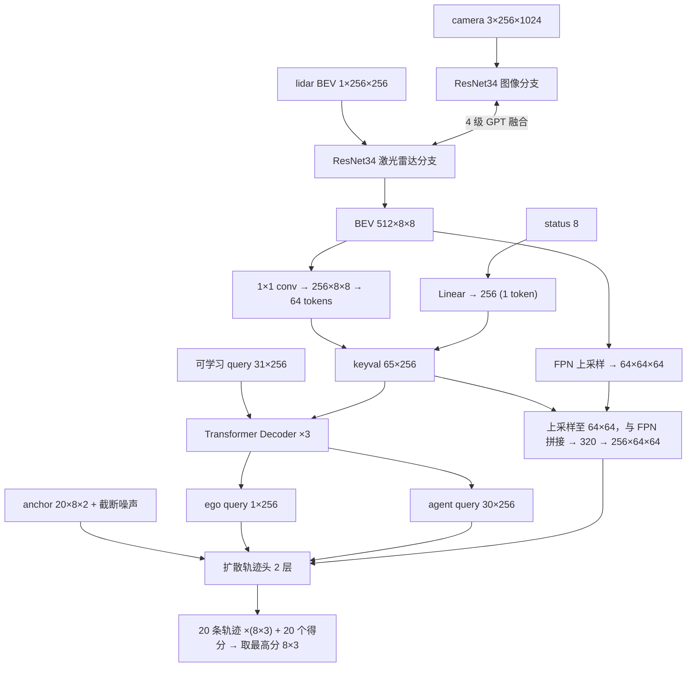

# DiffusionDrive(V2) 网络结构详解

对应代码：`DiffusionDriveV2/navsim/agents/diffusiondrive/transfuser_model_v2.py`（`V2TransfuserModel`），即 `scripts/train/train_rellis_il.py` 实际训练的模型。

文中维度均省略 batch 维，并由 v7 checkpoint（`log/rellis_il_finetune_v7/ckpts/last.ckpt`）实际前向时的 hook 打印验证。

总参数量 **60.7M**。

---

## 目录

0. [基础模块的行为](#0-基础模块的行为)
1. [输入](#1-输入)
2. [感知骨干：TransFuser](#2-感知骨干transfuser)
3. [场景编码：Transformer Decoder](#3-场景编码transformer-decoder)
4. [轨迹头：截断扩散](#4-轨迹头截断扩散)
5. [辅助头](#5-辅助头)
6. [参数分布](#6-参数分布)
7. [与实验现象的对应](#7-与实验现象的对应)

---

## 总览

---

## 0. 基础模块的行为

### Linear / MLP

`Linear(d_in, d_out)`：\(y = Wx + b\)。

- 对 \(N \times d_{in}\) 的输入逐行（逐 token）独立施加同一变换，输出 \(N \times d_{out}\)。
- MLP 是 Linear 与非线性激活交替堆叠，用于逐 token 地加工特征。
- token 之间不交换信息。

### 卷积 Conv2d

卷积核为 \(C_{out} \times C_{in} \times k \times k\)，在空间上滑动、共享权重，可以看成"局部的 Linear"。

- 输出的每个位置只依赖输入的 \(k \times k\) 邻域。
- stride=2 时空间尺寸减半。网络越深，通道越多、分辨率越低：空间信息逐步压入通道维，单个位置的感受野越来越大。
- 1×1 卷积等价于对每个像素做一次 Linear，只改变通道数。

### ResNet34

- 由 3×3 卷积块组成，每块是残差结构 \(y = x + F(x)\)，使深层网络易于训练。
- 共 4 个 stage，每个 stage 分辨率减半、通道翻倍：64 → 128 → 256 → 512，总下采样 32 倍。
- 在 ImageNet 上预训练过，已具备边缘、纹理、物体等通用视觉特征，这里在其基础上微调。

### 注意力 Attention

给定 \(Q \in \mathbb{R}^{N_q \times d}\)，\(K, V \in \mathbb{R}^{N_k \times d}\)：

\[
\text{Attn}(Q,K,V) = \text{softmax}\!\left(\frac{QK^\top}{\sqrt d}\right) V
\]

- \(QK^\top\) 是 \(N_q \times N_k\) 的相似度矩阵；softmax 后每行是一组和为 1 的权重。
- 输出的每一行是对 \(V\) 各行**按内容加权的平均**：每个查询自行决定从哪些 token 读取信息。
- Q、K、V 分别由输入经过独立的 Linear 得到，"关注什么"是学出来的。
- **多头**：把 \(d\) 维拆成 h 份，各算一套注意力后拼接，能同时建模不同类型的关系。
- **自注意力**：Q、K、V 来自同一组 token，用于组内信息交换。
- **交叉注意力**：Q 来自一组 token，K、V 来自另一组，用于前者读取后者。
- 与卷积相比：卷积看局部、权重固定；注意力看全局、权重依赖内容。

### Transformer 层

- **Encoder 层**：自注意力 + FFN（MLP），每个子层都有残差连接和 LayerNorm。
- **Decoder 层**：自注意力 + 交叉注意力 + FFN。
- **可学习 query**（DETR 范式）：用 `nn.Embedding` 定义固定数量的可训练向量作为 Q，通过交叉注意力读取场景。每个 query 训练后专门负责一类输出，如规划或检测。

### 位置编码

注意力是**置换不变**的，本身不知道 token 的位置，需要额外加入位置向量。

- **可学习位置编码**：`nn.Embedding`，每个位置一个可训练向量。
- **正弦编码**：

\[
[\sin(\omega_i p), \cos(\omega_i p)]_{i}, \quad \omega_i \text{ 按几何级数分布}
\]

  把标量（坐标、扩散步 t）映射为高维向量，不同频率分别编码粗尺度和细尺度。MLP 处理这种向量比处理原始标量容易得多。

### FiLM 调制

用条件向量 \(c\) 生成逐通道的缩放和平移：

\[
x \leftarrow x \cdot (1 + \gamma(c)) + \beta(c)
\]

这样可以让同一套网络的行为随条件改变。这里的条件是扩散步 t。

### 可变形 / 采样式注意力

不和全部像素计算相似度，只在少数**指定位置**用 `grid_sample` 双线性插值取特征，再加权求和。计算量小，空间指向也明确。

---

## 1. 输入

| 输入 | 形状 | 含义 |
|---|---|---|
| `camera_feature` | 3×256×1024 | 前视相机 RGB，归一化到 [0, 1]（采集另存同视角 `cam_depth` / `depth_feature`，建库时可改用深度） |
| `lidar_feature` | 1×256×256 | 激光雷达 BEV（±32 m，4 px/m）。**本分支默认高程**：底盘系 max-z 映射到 `[0,1]`（`elev∈[-3,4]` m）；旧版为点数直方图（截断 5 后归一化） |
| `status_feature` | 8 | **导航条件（方案 B，默认）**：自车系目标 `[gx,gy]/32`→`[-1,1]` + 底盘 Cardan `[roll,pitch]/π`→`[-1,1]`，共 4 维；后接自车系 `vx,vy,ax,ay`。旧版为 L/S/R/U one-hot（`status_nav_mode=command`） |

坐标约定：自车系 x 向前，y 向左。

---

## 2. 感知骨干：TransFuser

两个 ResNet34 各 21.3M 参数，激光雷达分支第一层卷积的 `in_chans` 为 1。两路并行前进，每个 stage 结束后做一次融合：

| stage | 相机特征 | 激光雷达特征 | 融合 token（数量 × 维度） |
|---|---|---|---|
| 1 | 64×64×256 | 64×64×64 | (8×32 + 8×8) = 320 × 64 |
| 2 | 128×32×128 | 128×32×32 | 320 × 128 |
| 3 | 256×16×64 | 256×16×16 | 320 × 256 |
| 4 | 512×8×32 | 512×8×8 | 320 × 512 |

### 每次融合的步骤（`transformers.{0..3}`，共 8.69M 参数）

1. 用 `AdaptiveAvgPool2d` 把相机特征池化到 8×32，激光雷达特征池化到 8×8。
2. 展平拼接为 320 个 token，加上可学习位置编码。
3. 经过 GPT 式自注意力 Transformer：`n_layer=2`，`n_head=4`，MLP 扩张倍数 `block_exp=4`。
4. 拆回两部分，双线性上采样到各自原分辨率，**以残差方式加回**各自分支。

### 为什么这样融合

- 相机是透视视角，激光雷达 BEV 是俯视视角，两者像素没有简单的对应关系。
- 自注意力不需要显式的几何投影，就能学到"图像中的哪一块对应 BEV 中的哪一块"。
- 在 4 个尺度上都做融合：低层交换纹理信息，高层交换语义信息。

### 骨干输出（只取激光雷达分支，规划在 BEV 坐标系下进行）

| 名称 | 形状 | 说明 |
|---|---|---|
| `bev_feature` | 512×8×8 | 最深层，每格约 8 m |
| `bev_feature_upscale` | 64×64×64 | FPN 式上采样：`c5_conv`（1×1，512→64），再两次"上采样 + 3×3 卷积"，每格约 1 m |

---

## 3. 场景编码：Transformer Decoder

### 构造 key/value

| 步骤 | 模块 | 形状 |
|---|---|---|
| BEV 降维 | `_bev_downscale`（1×1 conv） | 512×8×8 → 256×8×8 → 展平为 64×256 |
| 状态编码 | `_status_encoding`（`Linear(8, 256)`） | 8 → 1×256 |
| 拼接 | — | **keyval：65×256** |
| 位置编码 | `_keyval_embedding`（`Embedding(65, 256)`） | 逐元素相加 |

### 查询与解码

- 可学习 query：`_query_embedding`，**31×256**。
  - 第 0 个：ego query，负责规划。
  - 第 1–30 个：agent query，负责检测。
- `_tf_decoder`：3 层 `nn.TransformerDecoder`，`d_model=256`，`nhead=8`，`d_ffn=1024`，参数 3.16M。
  - 每层先对 31 个 query 做自注意力，再对 keyval 做交叉注意力，最后经过 FFN。
- 输出拆分为：
  - **ego query：1×256**
  - **agent queries：30×256**

### 给轨迹头使用的 cross-BEV 特征

1. 把 keyval 前 64 个 token 还原为 256×8×8，双线性插值到 64×64。
2. 与 `bev_feature_upscale`（64×64×64）在通道维拼接，得到 **320×64×64**。
3. `bev_proj`（逐像素的 Linear + ReLU + LN）：320 → 256，得到 **256×64×64**。

结果同时具备深层语义和约 1 m 的空间分辨率。

---

## 4. 轨迹头：截断扩散

参数 4.95M。

### 4.1 扩散模型的原理

**前向过程（加噪）**：

\[
x_t = \sqrt{\bar\alpha_t}\, x_0 + \sqrt{1-\bar\alpha_t}\, \epsilon, \quad \epsilon \sim \mathcal N(0, I)
\]

- 共 1000 步，`beta_schedule="scaled_linear"`。t 越大，噪声占比越大。

**网络学习反向过程**：给定 \(x_t\) 与 t，预测干净样本 \(x_0\)。代码中 `prediction_type="sample"`，即直接预测 \(x_0\)，而不是预测噪声 \(\epsilon\)。

**推理（DDIM）**：由 \(x_t\) 和网络给出的 \(\hat x_0\)，按确定性公式算出 \(x_{t'}\)（\(t' < t\)），迭代若干次。

**为什么适合规划**：扩散学到的是完整的条件分布，可以生成多个合理解，比如左绕和右绕。直接回归只给出一个均值，在多解场景下容易落在两解之间，恰好撞上障碍物。

**"截断"的含义（DiffusionDrive 的做法）**：

- 不从纯噪声出发，而是从 20 条 anchor 出发，只加少量噪声：
  - 训练：\(t \sim U[0, 50)\)
  - 推理：\(t = 8\)
- 推理只需去噪 2 步。
- anchor 提供"大致往哪走"的先验，网络只学习如何修正。

### 4.2 前向流程

#### ① 带噪 anchor

| 步骤 | 形状 / 说明 |
|---|---|
| `plan_anchor` | 20×8×2：20 条路线，每条 8 个 xy 点（t = 0.5, 1.0, …, 4.0 s） |
| `norm_odo` | 归一化到 [-1, 1]：\(x' = 2(x+1.2)/56.9 - 1\)，\(y' = 2(y+20)/46 - 1\) |
| `add_noise` | 按扩散公式加噪，clamp 到 [-1, 1] |
| `denorm_odo` | 反归一化回米制，得到 `noisy_traj_points`：20×8×2 |

#### ② 轨迹与时间编码

| 步骤 | 模块 | 形状 |
|---|---|---|
| 点坐标正弦编码 | `gen_sineembed_for_position(hidden_dim=64)`：x、y 各 32 维，每点 64 维 | 20×8×64 → 展平为 20×512 |
| 轨迹特征 | `plan_anchor_encoder`（MLP 512 → 256 → 256） | **traj_feature：20×256**，每条候选轨迹一个 query |
| 时间编码 | `time_mlp`（正弦编码 256 → 1024 → Mish → 256） | **time_embed：1×256** |

#### ③ 扩散解码器 × 2 层（`CustomTransformerDecoderLayer`）

每层依次执行以下子模块，特征形状始终为 **20×256**：

| 子模块 | 输入 → 输出 | 行为 |
|---|---|---|
| `cross_bev_attention`（`GridSampleCrossBEVAttention`） | 20×256，20×8×2，256×64×64 → 20×256 | 对每条轨迹的 8 个点，用 `F.grid_sample` 在 cross-BEV 特征上双线性取样，得到 8×256。`Linear(256, 8)` 由 query 生成 8 个点的权重，softmax 后加权求和，再经输出投影。**相当于"沿候选路线读取地形与障碍"。** |
| `cross_agent_attention` | 20×256，30×256 → 20×256（注意力 20×30） | 对 30 个 agent query 做多头交叉注意力，加残差和 LayerNorm。城市场景中用于感知周围车辆；越野数据没有检测监督，作用有限。 |
| `cross_ego_attention` | 20×256，1×256 → 20×256 | 对 ego query 做交叉注意力，加残差和 LayerNorm。ego query 中已融合了场景和自车状态。 |
| `ffn` + `norm3` | 20×256 → 20×256 | 256 → 1024 → 256 |
| `time_modulation`（FiLM） | 20×256，1×256 → 20×256 | Mish + Linear(256 → 512)，拆成 scale 和 shift，\(x(1+\text{scale}) + \text{shift}\)。告诉网络当前噪声水平，以调节修正幅度。 |
| `task_decoder`（`DiffMotionPlanningRefinementModule`） | 20×256 → 20×8×3，20 | 回归分支：256 → 256 → 256 → 24，reshape 为 8×(Δx, Δy, θ)。分类分支：256 → 1，得到每条轨迹的 logit。 |

后处理：

- xy 采用**残差形式**：\(\hat{xy} = \text{noisy\_xy} + \Delta\)。
- 朝向：\(\theta = \tanh(\cdot) \cdot \pi\)。
- 第 1 层的输出 xy（`detach` 后）作为第 2 层的输入点，逐层迭代精修。

#### ④ 训练与推理

**训练**（`LossComputer`）：

- 对每个样本，找出与 GT 轨迹最近的 anchor，作为正模式。
- 仅对正模式的预测计算 L1 回归损失。
- 对 20 个 logit 计算分类损失（focal），让正模式得分最高。
- 两层解码器的输出都计算损失（深监督）。

**推理**（`forward_test`）：

- 在 t = 8 加噪，执行 `roll_timesteps = [10, 0]` 两步。
- 每步运行一次 2 层解码器，把预测的 \(\hat x_0\) 交给 `DDIMScheduler.step` 更新。
- 最后取 argmax 得分对应的轨迹，输出 **trajectory：8×3**。

---

## 5. 辅助头

越野训练中未使用。

| 头 | 结构 | 输入 → 输出 |
|---|---|---|
| `_agent_head` | MLP 256 → 1024 → 5；Linear 256 → 1 | 30×256 → 30×5 检测框 (x, y, θ, l, w) + 30 个置信度 |
| `_bev_semantic_head` | 3×3 conv → 1×1 conv → 双线性上采样 | 64×64×64 → 7×128×256 语义 BEV（车前半区域） |

这两个头在 NAVSIM 上提供辅助监督，帮助骨干学到更好的场景表征。RELLIS 与 Verti-Bench 数据没有对应标注，`train_rellis_il.py` 只使用 `trajectory_loss`。

---

## 6. 参数分布

| 模块 | 参数量 |
|---|---|
| `_backbone.image_encoder`（ResNet34） | 21.28M |
| `_backbone.lidar_encoder`（ResNet34） | 21.28M |
| `_backbone.transformers`（4 级融合 GPT） | 8.69M |
| `_tf_decoder` | 3.16M |
| `_trajectory_head` | 4.95M |
| `_agent_head` | 0.27M |
| `_bev_semantic_head` | 0.04M |
| **合计** | **60.7M** |

---

## 7. 与实验现象的对应

### 模式塌缩

- 20 个轨迹 query 经过**同一套解码器权重**，读取的 cross-BEV 特征和 ego query 也完全相同。
- 各 query 之间唯一的差异，来自 anchor 的位置编码和 grid_sample 的采样位置。
- anchor 彼此很近时，这两项差异都很小，网络容易对所有模式输出几乎相同的修正量。
- 训练损失只监督匹配上的那个模式，没有任何项鼓励模式之间保持多样性。
- DDV2 的 RL 阶段通过显式奖励多样性来缓解这个问题。

### 折线轨迹

- `norm_odo` 的归一化范围是按 NAVSIM 设定的（x 跨度 56.9 m，y 跨度 46 m）。
- 同等大小的归一化噪声，对应到越野低速、短距离的轨迹上，相对幅度过大。
- 2 步去噪不足以完全平滑。

### 加入高程通道

- 只需把激光雷达 ResNet 的 `in_chans` 改为 2。
- 第一层卷积权重扩展一个输入通道：复制原通道权重，或零初始化新通道。
- 其余维度不变。

### anchor 数量

- `ego_fut_mode=20` 同时写死在 `TrajectoryHead` 和 `CustomTransformerDecoderLayer` → `DiffMotionPlanningRefinementModule` 中。
- 改用 8 条 anchor 需要同步修改这几处。
